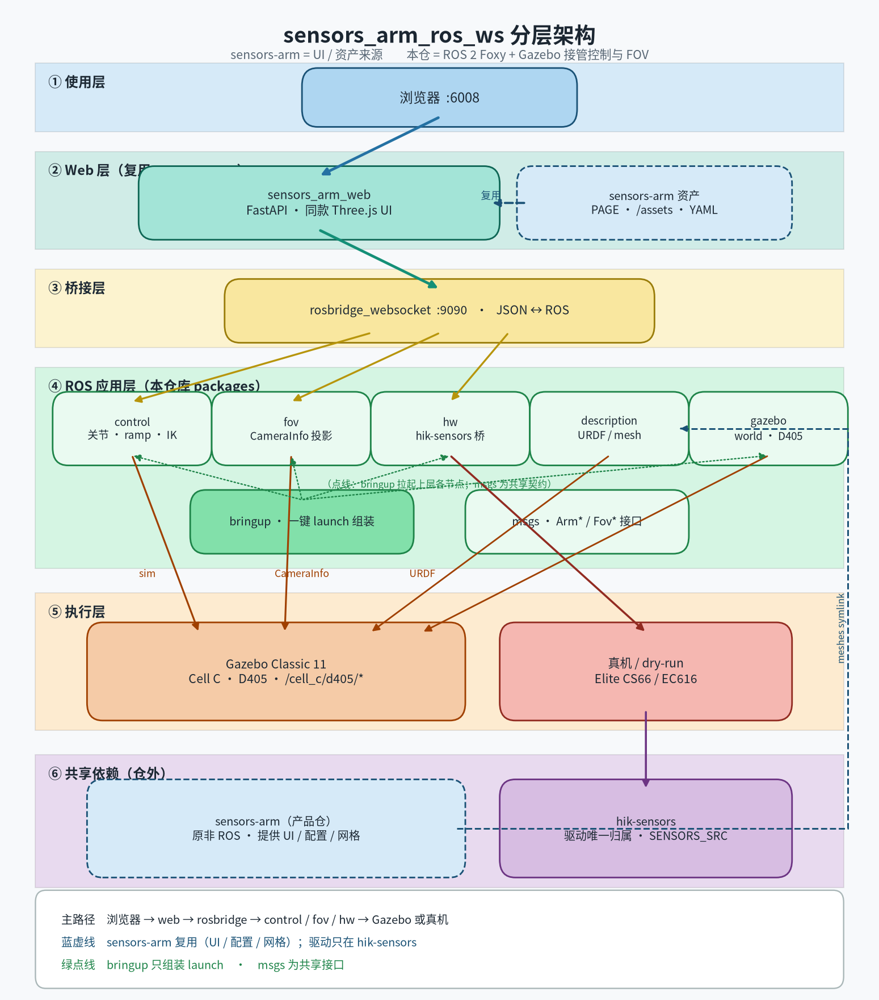
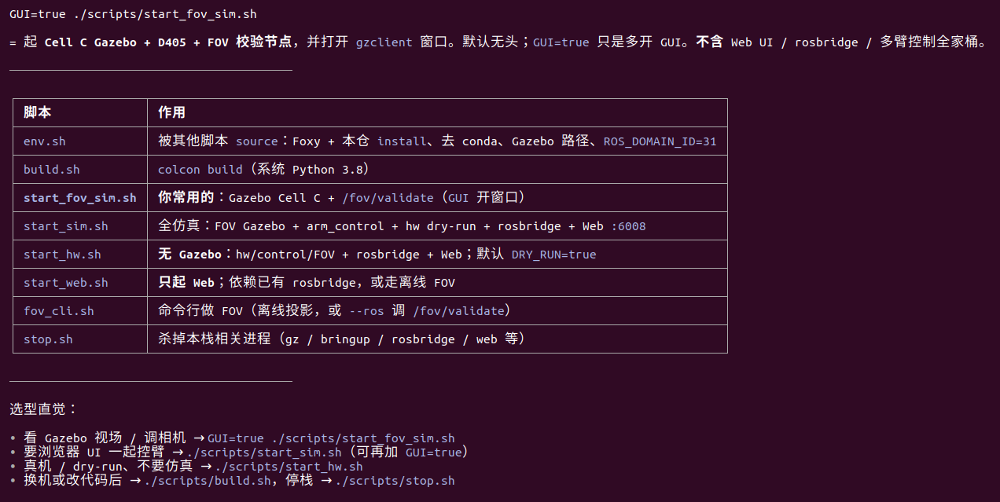

# sensors_arm_ros_ws

ROS 2 **Foxy** + Gazebo Classic 11 工作区：把 [sensors-arm](https://github.com/fszhangYi/sensors-arm) 的多 Cell 可视化 / 控制迁到 ROS，Cell C 腕部 **Intel RealSense D405** 视场以 Gazebo `CameraInfo` 投影为**主验收路径**。

| | |
|---|---|
| **Stack** | ROS 2 Foxy · Gazebo 11 · rosbridge · FastAPI Web |
| **Focus** | Cell C wrist-cam FOV · arm command / IK · hw bridge |
| **UI** | http://127.0.0.1:6008/ → WebSocket rosbridge `:9090` |
| **Drivers** | [hik-sensors](https://github.com/fszhangYi/sensors)（本仓只做桥，不 fork） |

---

## Architecture

浏览器与仿真 / 真机之间，经 Web → rosbridge → ROS 分层；**命令以 service 为主，topic 回流状态与相机流**。



| Layer | What |
|-------|------|
| ① Use | Browser `:6008` |
| ② Web | `sensors_arm_web`（复用 sensors-arm PAGE / assets / YAML） |
| ③ Bridge | rosbridge WebSocket `:9090` |
| ④ ROS | control · fov · hw · description · gazebo · bringup · msgs |
| ⑤ Exec | Gazebo（仿真）或真机 / dry-run |
| ⑥ Shared | sensors-arm 产品仓 · hik-sensors 驱动 |

```text
Browser ──HTTP──► sensors_arm_web(:6008)
                      │
                      │  rosbridge (ws://:9090)
                      ▼
              ┌── services ──────────────────────────┐
              │  /fov/validate · /fov/set_gazebo_camera│
              │  /arm/command · /arm/ik · /arm/connect │
              └──────────────────────────────────────┘
              ┌── topics (state / sensors) ───────────┐
              │  /joint_states · CameraInfo · image_*  │
              └──────────────────────────────────────┘
                      │                    │
                 Gazebo Cell C        hw_bridge → hik-sensors
```

细节见 [`docs/architecture.md`](docs/architecture.md)。

---

## Scripts（推荐入口）



```bash
cd ~/autodl-tmp/sensors_arm_ros_ws   # or your clone path

./scripts/build.sh                   # 首次 / 改代码后（系统 Python 3.8，勿混 conda）

GUI=true ./scripts/start_fov_sim.sh  # 看 Gazebo 视场 / 调相机（常用）
./scripts/start_sim.sh               # 全仿真 + Web UI :6008
./scripts/start_hw.sh                # 真机 / dry-run（无 Gazebo）
./scripts/start_web.sh               # 仅 Web（依赖已有 rosbridge 或离线 FOV）

./scripts/fov_cli.sh                 # 离线投影 HD87
./scripts/fov_cli.sh --ros           # 调用 /fov/validate
./scripts/stop.sh                    # 停本栈
```

| Script | Role |
|--------|------|
| `env.sh` | 被其他脚本 `source`：Foxy + 本仓 install、去 conda、Gazebo 路径、`ROS_DOMAIN_ID=31` |
| `build.sh` | `colcon build`（系统 Python 3.8） |
| `start_fov_sim.sh` | Gazebo Cell C + `/fov/validate`；`GUI=true` 开 `gzclient` |
| `start_sim.sh` | FOV Gazebo + arm_control + hw dry-run + rosbridge + Web `:6008` |
| `start_hw.sh` | 无 Gazebo：hw / control / FOV + rosbridge + Web；默认 `DRY_RUN=true` |
| `start_web.sh` | 只起 Web |
| `fov_cli.sh` | FOV CLI（离线或 `--ros`） |
| `stop.sh` | 结束 gz / bringup / rosbridge / web 等 |

**选型：** 调 FOV → `start_fov_sim` · 浏览器控臂 → `start_sim` · 真机 → `start_hw` · 停栈 → `stop`。

### Environment variables

| Variable | Default | Meaning |
|----------|---------|---------|
| `WEB_PORT` | `6008` | Web 端口 |
| `START_WEB` | `true` | launch 是否起 Web |
| `GUI` | `false` | 是否启动 Gazebo `gzclient` |
| `DRY_RUN` | `true` | `start_hw.sh` dry-run |
| `ARM_ID` | `arm-c` | 默认工位 |
| `ROS_DOMAIN_ID` | `31`（`SENSORS_ARM_ROS_DOMAIN_ID`） | 与本机其它 ROS 2 隔离 |
| `ROS_LOCALHOST_ONLY` | `0`（`SENSORS_ARM_ROS_LOCALHOST_ONLY`） | 仅本机 DDS（Gazebo 插件对 `1` 可能不友好） |
| `SENSORS_SRC` | `~/autodl-tmp/sensors/src` | hik-sensors 源码路径 |

---

## Packages

| Package | Role |
|---------|------|
| `sensors_arm_description` | EC616 / CS66 / Cell C xacro · D405 optical · 网格 symlink |
| `sensors_arm_gazebo` | Cell C world · camera plugin · frustum viz · 无头 launch |
| `sensors_arm_msgs` | `FovValidate` · `SetGazeboCamera` · `ArmCommand` · `ArmConnect` · `ArmIk` |
| `sensors_arm_fov` | 视场校验节点 · CLI · 几何对照 |
| `sensors_arm_control` | Sim 关节 · abs ramp · IK |
| `sensors_arm_hw` | hik-sensors 桥（dry_run / hardware） |
| `sensors_arm_web` | Three.js UI（`:6008`）→ rosbridge |
| `sensors_arm_bringup` | 一键 launch |

---

## Manual commands

### Environment

```bash
# Foxy 必须用系统 Python 3.8，不要用 conda
source ~/autodl-tmp/sensors_arm_ros_ws/scripts/env.sh
```

### Build

```bash
./scripts/build.sh
# or:
colcon build --symlink-install --cmake-args -DPYTHON_EXECUTABLE=/usr/bin/python3
```

### Launch

```bash
ros2 launch sensors_arm_bringup cell_c_gazebo_fov.launch.py gui:=true
ros2 launch sensors_arm_bringup multi_cell_sim.launch.py
ros2 launch sensors_arm_bringup hardware.launch.py dry_run:=true
```

### FOV

```bash
CFG=$(ros2 pkg prefix sensors_arm_fov)/share/sensors_arm_fov/config/cell_c_fov.yaml

ros2 run sensors_arm_fov fov_cli -c "$CFG" --mode HD87          # offline
ros2 run sensors_arm_fov fov_cli -c "$CFG" --mode HD87 --ros    # needs sim
ros2 run sensors_arm_fov fov_cli -c "$CFG" --mode HD87 --ros --zip /tmp/fov.zip

ros2 topic list | grep -E 'd405|joint_states|clock'
ros2 service list | grep fov
```

### Control (sim)

`start_sim.sh` 下 Web / `/arm/command` 改 `/joint_states`；Gazebo 用运动学插件每步 `SetPosition` 跟随（无动力学 PID）。

```bash
ros2 service call /arm/command sensors_arm_msgs/srv/ArmCommand \
  "{command: {arm_id: 'arm-c', action: 'connect', joints: [], jog_delta: [], speed_scale: 1.0, cancel_abs_ramp: false}}"

ros2 service call /arm/command sensors_arm_msgs/srv/ArmCommand \
  "{command: {arm_id: 'arm-c', action: 'home', joints: [], jog_delta: [], speed_scale: 1.0, cancel_abs_ramp: false}}"
```

### Web only

```bash
./scripts/start_web.sh
# or:
source ./scripts/env.sh
~/autodl-tmp/.venv/bin/python -m sensors_arm_web.web_server --port 6008 --mode sim
```

### Description / debug

```bash
xacro $(ros2 pkg prefix sensors_arm_description)/share/sensors_arm_description/urdf/cell_c.urdf.xacro > /tmp/cell_c.urdf
ros2 launch sensors_arm_description display.launch.py
```

---

## Related repositories

| Repo | Role |
|------|------|
| [sensors](https://github.com/fszhangYi/sensors) | hik-sensors 核心驱动（唯一归属） |
| [sensors-arm](https://github.com/fszhangYi/sensors-arm) | 非 ROS 多臂 UI / 配置 / 网格（本仓复用） |
| **sensors_arm_ros_ws**（本仓） | ROS 2 + Gazebo 迁移与 FOV 主验收 |

布局约定：工作区旁放置 `sensors` 与 `sensors-arm`；`description` 网格多为指向 `sensors-arm/.../meshes` 的 **symlink**。

---

## Notes

- ROS 节点跑 **Python 3.8 + Foxy**；`colcon build` 不要带 conda。
- Web（FastAPI）可用独立 venv（如 3.12），经 rosbridge 连 ROS。
- 产品视场路径是 **CameraInfo 投影**；几何 `fov.analyze` 仅对照，见 `src/sensors_arm_fov/scripts/compare_geom_vs_sim.py`。
- 默认 `ROS_DOMAIN_ID=31`，避免与本机其它 ROS 2（如 Foxglove snap）串扰。
