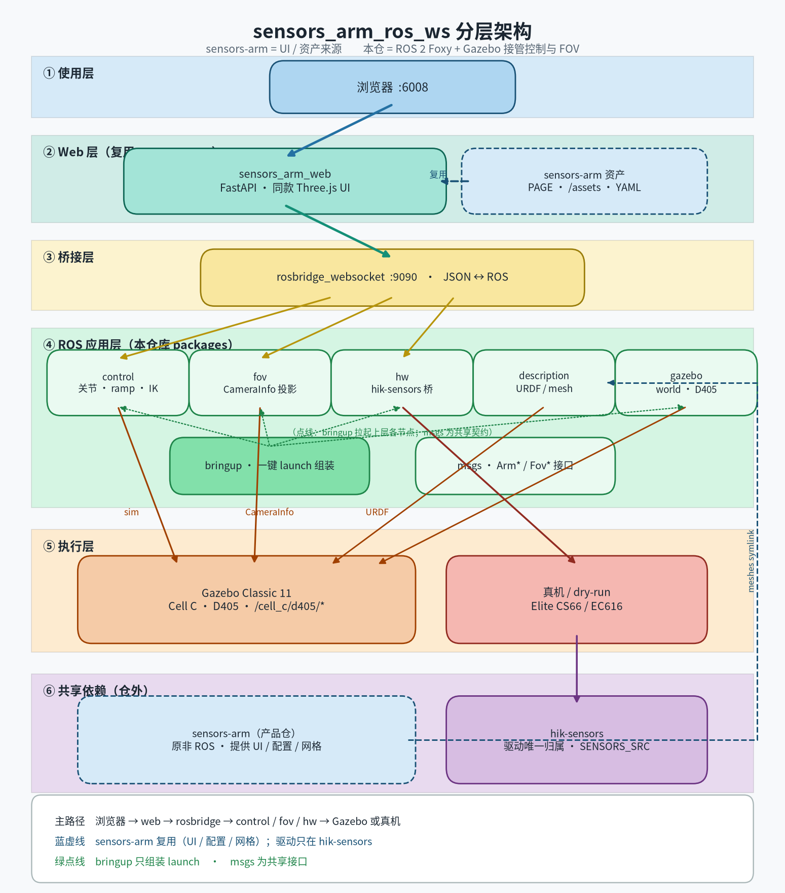

# 架构说明：sensors_arm_ros_ws ↔ sensors-arm



[SVG](architecture.svg) · 生成脚本：[render_architecture.py](render_architecture.py)

```bash
cd docs
python3 render_architecture.py
```

## 六层（自上而下）

| 层 | 内容 |
|----|------|
| ① 使用层 | 浏览器 `:6008` |
| ② Web 层 | `sensors_arm_web`，复用 sensors-arm 的 PAGE / assets / YAML |
| ③ 桥接层 | rosbridge `:9090` |
| ④ ROS 应用层 | control / fov / hw / description / gazebo + bringup / msgs |
| ⑤ 执行层 | Gazebo（仿真）或真机 dry-run |
| ⑥ 共享依赖 | sensors-arm 产品仓、hik-sensors 驱动 |

## 与 sensors-arm

- **sensors-arm**：原非 ROS 产品；提供 UI、配置、网格。
- **本仓**：同 UI 迁到 ROS + Gazebo；控制与 FOV 走 ROS；FOV 主验收 = Gazebo `CameraInfo`。
- **hik-sensors**：驱动唯一归属；本仓 `hw` 只做桥，不 fork 驱动。
